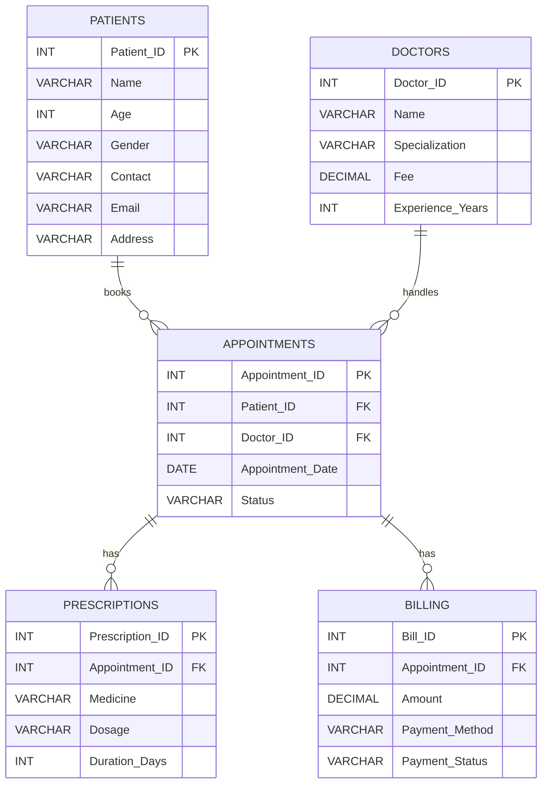

# MediTrack 🏥 — Healthcare Database Management System

## 📌 Project Overview

**MediTrack** is a MySQL-based healthcare database project designed to manage patient information, doctor details, appointments, prescriptions, and billing records.

The project demonstrates how a relational database can organize healthcare information using primary keys, foreign keys, table relationships, and SQL queries.

## 🎯 Project Objectives

- Store and manage patient and doctor information.
- Maintain appointment records and appointment statuses.
- Track prescriptions associated with appointments.
- Store billing and payment information.
- Practice SQL queries and relational database concepts.

## 🛠️ Technologies Used

- **Database:** MySQL 8.0
- **Query Language:** SQL
- **Database Tool:** MySQL Shell
- **Version Control:** Git and GitHub

## 🗂️ Database Structure

The `MediTrack` database contains five tables:

| Table | Description | Sample Records |
|---|---|---:|
| `Patients` | Stores patient details | 20 |
| `Doctors` | Stores doctor details, specializations, fees, and experience | 15 |
| `Appointments` | Stores patient appointments and their statuses | 10 |
| `Prescriptions` | Stores medicines prescribed for appointments | 13 |
| `Billing` | Stores appointment charges and payment details | 10 |

## 🔗 Entity Relationship Diagram (ERD)



## 🏗️ Database Architecture

MediTrack follows a **relational database architecture** in which data is organized into five interconnected tables. Primary keys uniquely identify records, while foreign keys connect related information across tables.

### Architecture Overview

```text
                    MediTrack Database
                            |
          +-----------------+-----------------+
          |                 |                 |
      Patients           Doctors          Appointments
          |                 |                 |
          +--------+--------+                 |
                   |                           |
                   +---- Patient & Doctor -----+
                         Appointment Records
                                  |
                    +-------------+-------------+
                    |                           |
              Prescriptions                  Billing
                    |                           |
             Medicine Details          Payment Details
```

### Table Responsibilities

- **Patients:** Stores patient information, including name, age, contact details, and address.
- **Doctors:** Stores doctor information, including specialization, consultation fee, and years of experience.
- **Appointments:** Connects patients with doctors and stores appointment dates and statuses.
- **Prescriptions:** Stores medicines, dosages, and treatment durations linked to appointments.
- **Billing:** Stores appointment charges, payment methods, and payment statuses.

### Data Relationships

The `Appointments` table acts as the central table connecting patients and doctors. The `Patient_ID` and `Doctor_ID` foreign keys identify the patient and doctor associated with each appointment.

The `Prescriptions` and `Billing` tables use `Appointment_ID` as a foreign key to associate prescription and payment records with their respective appointments.

This architecture helps maintain data consistency, reduces unnecessary duplication, and makes it easier to retrieve related information using SQL joins.

## 💡 SQL Concepts Demonstrated

- Database and table creation
- Primary keys and foreign keys
- Data types and constraints
- Inserting sample records using `INSERT INTO`
- Retrieving records using `SELECT`
- Filtering records using `WHERE`
- Joining related tables using `JOIN`
- Managing relational data across multiple tables

## 🔍 Example SQL Queries

### 1. View all patients

```sql
SELECT * FROM Patients;
```

### 2. Find patients older than 40

```sql
SELECT *
FROM Patients
WHERE Age > 40;
```

### 3. Find doctors with more than 10 years of experience

```sql
SELECT *
FROM Doctors
WHERE Experience_Years > 10;
```

### 4. Find appointments after a specific date

```sql
SELECT *
FROM Appointments
WHERE Appointment_Date > '2024-01-08';
```

### 5. View appointments with patient and doctor details

```sql
SELECT
    A.Appointment_ID,
    P.Name AS Patient_Name,
    D.Name AS Doctor_Name,
    D.Specialization,
    A.Appointment_Date,
    A.Status
FROM Appointments A
JOIN Patients P
    ON A.Patient_ID = P.Patient_ID
JOIN Doctors D
    ON A.Doctor_ID = D.Doctor_ID;
```

### 6. View prescriptions with appointment details

```sql
SELECT
    A.Appointment_ID,
    P.Name AS Patient_Name,
    PR.Medicine,
    PR.Dosage,
    PR.Duration_Days
FROM Prescriptions PR
JOIN Appointments A
    ON PR.Appointment_ID = A.Appointment_ID
JOIN Patients P
    ON A.Patient_ID = P.Patient_ID;
```

### 7. View billing and payment details

```sql
SELECT
    B.Bill_ID,
    A.Appointment_ID,
    P.Name AS Patient_Name,
    B.Amount,
    B.Payment_Method,
    B.Payment_Status
FROM Billing B
JOIN Appointments A
    ON B.Appointment_ID = A.Appointment_ID
JOIN Patients P
    ON A.Patient_ID = P.Patient_ID;
```

## ⚙️ How to Run the Project

### Prerequisites

- MySQL Server 8.0 or a compatible version
- MySQL Shell or MySQL Workbench
- The `meditrack.sql` file from this repository

### Steps

1. Clone or download this repository from GitHub.
2. Open MySQL Shell or MySQL Workbench and connect to your MySQL server.
3. Open the `meditrack.sql` file.
4. Execute the SQL statements in the file.
5. Verify that the database and tables have been created successfully.
6. Run the example queries to explore the data.

**Note:** The SQL script creates the `MediTrack` database and selects it using `USE MediTrack;`, so you do not need to create the database separately.

If you are using MySQL Shell, you can execute the file with the `SOURCE` command after navigating to the directory containing it:

```sql
SOURCE /path/to/meditrack.sql;
```

Replace `/path/to/meditrack.sql` with the actual file path on your computer.

## 📁 Project Structure

```text
MediTrack-Healthcare-Database/
├── README.md
└── meditrack.sql
```

## 🚀 Future Improvements

- Add data validation and stronger constraints.
- Introduce appointment scheduling and availability checks.
- Add reports for revenue, appointments, and payment status.
- Build a frontend application connected to the database.
- Add user authentication and role-based access control.

## 📚 Learning Outcomes

Through this project, I practised designing a relational database, creating connected tables, enforcing referential integrity, inserting sample data, and retrieving meaningful information using SQL queries and joins.

## 👩‍💻 Author

Ananna Basak
B.Tech in Computer Science and Engineering, 2026

This project was developed as part of my learning journey in SQL and relational database management.

## 📌 Project Status

Status: Core database implementation completed.

This is an educational database project. The sample data is intended for demonstration and learning purposes.
